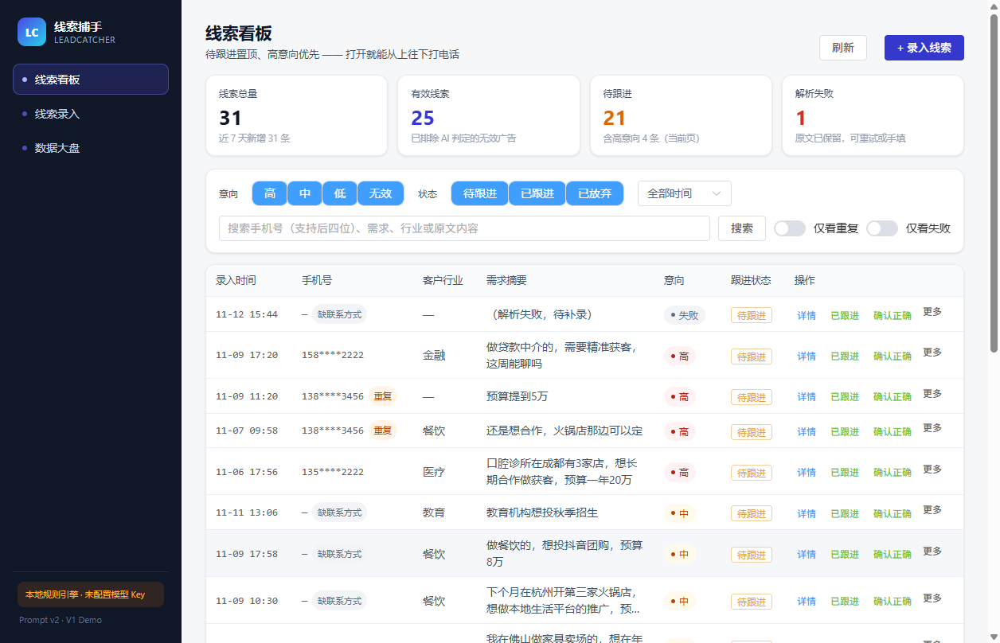
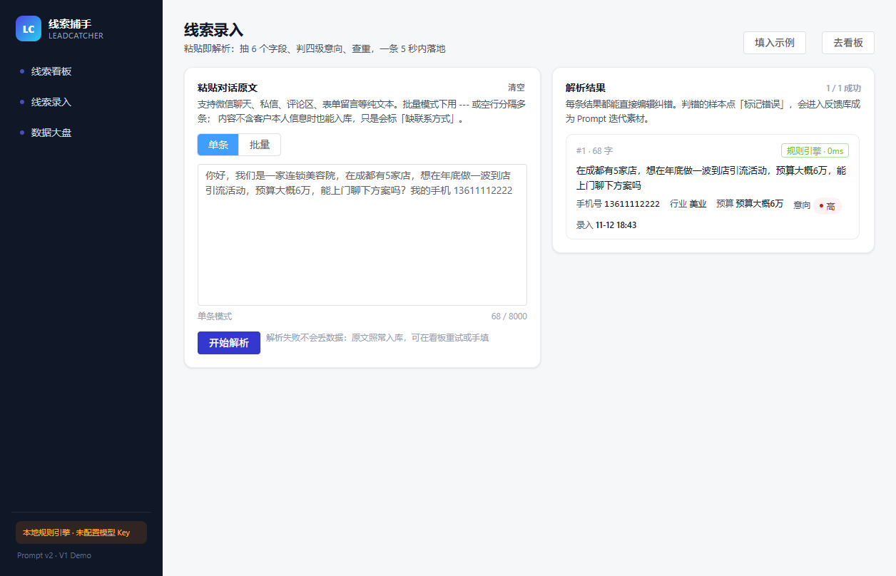
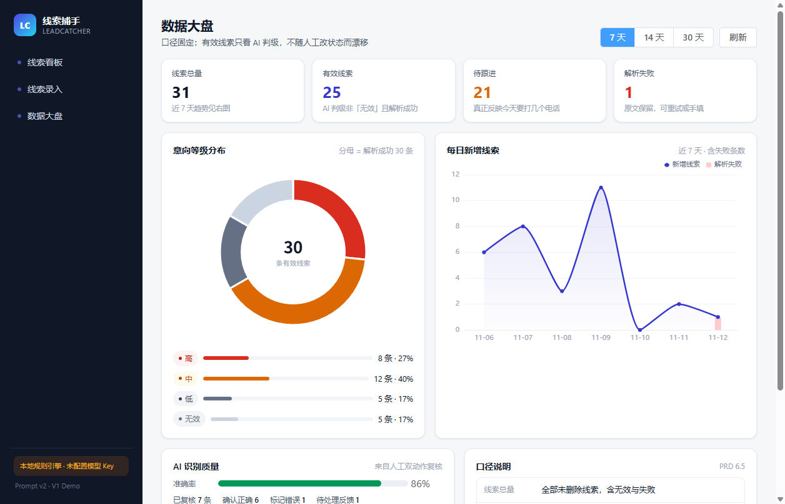

# 线索捕手 · LeadCatcher

> 把散落在微信、表单、私信里的零散咨询，变成一条条**可检索、可判级、可复盘**的结构化线索。

粘贴一段对话原文，5 秒内返回「手机号 / 行业 / 需求 / 预算 / 意向等级 / 风险备注」六字段；
线索进看板统一跟进，人工纠错回流成 Prompt 迭代依据。

`实习面试项目 · 全栈 Demo · 端到端交付` · 演示数据为脱敏样例



| 线索录入 | 数据大盘 |
| --- | --- |
|  |  |

---

## 它解决什么

| | 现在 | 用了之后 |
| --- | --- | --- |
| 单条线索整理 | 复制 → 读 → 提炼 → 判级 → 填 6 列 ≈ 3 分钟 | 粘贴 → 确认 ≤ 15 秒 |
| 判级标准 | 每人一套，因人而异 | 一份 rubric 写进 Prompt，一把尺子 |
| 漏跟进 | 靠 Excel 自己记 | 看板按「待跟进 + 意向」排序 |
| 复盘 | 说不清哪类线索质量差 | 准确率 / 无效占比 / Bad Case 分类可算 |

## 核心设计（面试重点）

1. **意向分级不靠感觉** —— 四级 rubric + 短路判定顺序（无效 → 高 → 中 → 低）+ 成本不对称论证。
2. **双动作复核** —— 每条线索都能「确认正确」或「标记错误」，准确率才有分母。
3. **解析失败不丢数据** —— 失败的线索照样入库、保留原文、可重试可手填。
4. **手机号防幻觉** —— LLM 抽取 + 正则二次校验，**冲突时以正则为准**；还会排除对方业务员的号码。
5. **Prompt 版本化** —— 每条线索记录 `prompt_version`，固定测试集回归，能回答"v2 比 v1 好在哪"。
6. **边界明确** —— 不接渠道 API、不做触达、不做权限体系，理由写在 [PRD 第 5 章](docs/PRD.md)。

## 实测数据（30 条标注测试集）

| 指标 | 结果 | 目标 |
| --- | --- | --- |
| 手机号提取 | 30/30 · **100%** | ≥ 95% |
| 意向分级 | 30/30 · **100%** | ≥ 80% |
| 客户行业 | 19/19 · **100%** | ≥ 85% |
| 预算摘录 | 12/12 · **100%** | ≥ 70% |
| 需求摘要 | 19/20 · **95%** | ≥ 80% |

> ⚠️ 这组数字来自 `provider = mock`（本地规则引擎），说明的是**标准落地了**，不是模型很聪明。
> 样本与 rubric 高度同构，真实噪声下会掉——失败案例和诚实分析见 [复盘记录](docs/retro/v1.md)。
> 配好 `LLM_API_KEY` 后跑 `run_eval.py` 即可得到模型版对照数据。

## 快速开始

```bash
# 1) 后端（Python 3.10+）
cd server
python -m venv .venv
.venv/Scripts/activate          # macOS/Linux: source .venv/bin/activate
pip install -r requirements.txt
cp .env.example .env            # 不填 Key 也能跑，会自动降级为规则引擎

python seed.py                  # 灌 31 条演示数据
python -m uvicorn app.main:app --reload --port 8000
# 接口文档：http://127.0.0.1:8000/docs

# 2) 前端（Node 18+）
cd web
npm install
npm run dev                     # http://localhost:5173 ，API 自动代理到 8000
```

**单服务部署**：`cd web && npm run build` 会把产物输出到 `server/app/static`，
此后只要启动 FastAPI，`http://127.0.0.1:8000` 就是完整应用。

**公网部署**：仓库内置 `render.yaml`（Render Blueprint），GitHub 授权后
**New + → Blueprint → 选本仓库** 即可，步骤与坑见 [部署说明](docs/deploy.md)。

```bash
# 3) 评测
cd server
python run_eval.py --verbose    # 30 条测试集，逐条明细
```

## 项目结构

```
leadcatcher/
├── docs/
│   ├── PRD.md                # 产品需求文档（19 章 + 2 附录）
│   ├── prompts/prompts.md    # Prompt 库（P1 提取 / P2 复判 / P3 归因聚类）
│   ├── eval/                 # 30 条标注测试集 + 评测口径
│   ├── retro/v1.md           # 迭代复盘（含踩坑与结论）
│   └── prototype/            # 页面截图
├── server/
│   ├── app/
│   │   ├── main.py           # FastAPI 路由 + 静态托管
│   │   ├── services.py       # 业务编排：解析 / 去重 / 看板 / 统计口径
│   │   ├── llm.py            # 模型接入 + 四道校验 + 失败重试
│   │   ├── mock_engine.py    # 规则引擎（无 Key 降级 + 评测基线）
│   │   ├── prompt.py         # Prompt 资产（代码侧副本）
│   │   ├── phone.py          # 手机号正则二次校验 + 号码归属判断
│   │   └── dedup.py          # 强重复 / 疑似重复
│   ├── seed.py               # 演示数据
│   └── run_eval.py           # 评测脚本
└── web/
    └── src/
        ├── views/            # 看板 / 录入 / 大盘
        └── components/       # 详情抽屉 + 纠错表单
```

## 技术栈与取舍

| 层 | 选型 | 为什么 |
| --- | --- | --- |
| 前端 | Vue 3 + Vite + Element Plus + ECharts | 后台表格/表单开箱即用，能省一天 |
| 后端 | Python FastAPI | 自动 Swagger（演示可直接给面试官看接口），异步调模型顺手 |
| 数据库 | SQLite | 零部署、单文件可备份，Demo 够用 |
| 大模型 | DeepSeek（OpenAI 兼容协议） | 换模型只改 `.env` 的 `LLM_BASE_URL`，代码不动 |
| 降级 | 内置规则引擎 | 没配 Key 也不白屏，同时是评测基线 |

## 接口一览

| 方法 | 路径 | 说明 |
| --- | --- | --- |
| POST | `/api/leads/parse` | 解析并入库（含文本幂等） |
| GET | `/api/leads` | 列表：意向 / 状态 / 时间 / 关键词筛选 |
| PATCH | `/api/leads/{id}` | 编辑、改状态、解除重复标记 |
| POST | `/api/leads/{id}/verify` | 确认正确 / 标记错误 |
| POST | `/api/leads/{id}/retry` | 重试解析 |
| POST | `/api/feedbacks` | 提交纠错（进入反馈库） |
| GET | `/api/stats?days=7` | 大盘聚合（口径在后端） |
| GET | `/api/export` | 导出 CSV |

## 文档索引

| 文档 | 内容 |
| --- | --- |
| [PRD](docs/PRD.md) | 需求、边界、AI 契约、分级标准、12 条验收清单 |
| [Prompt 库](docs/prompts/prompts.md) | 提取 / 复判 / 归因聚类三个 Prompt + 版本记录 |
| [测试集](docs/eval/) | 30 条标注样本 + 判定口径 |
| [复盘记录](docs/retro/v1.md) | 第 1 轮迭代：跑分、改了什么、踩了什么坑 |
| [部署说明](docs/deploy.md) | Render 一键部署、免费实例限制、产物提交的取舍 |
| [原型截图](docs/prototype/) | 看板 / 录入 / 大盘 / 详情 / 纠错 |

## 进度

- [x] **D1** PRD + 边界 + 分级标准
- [x] **D1** 30 条测试集 + Prompt 库 v1/v2
- [x] **D2** 数据模型 + 录入 + LLM 解析打通（含降级）
- [x] **D3** 看板 + 筛选 + 去重
- [x] **D4** 数据大盘 + 反馈闭环
- [x] **D5** 测试集回归 + 复盘记录
- [ ] **D6** 公网部署（Render）+ 演示录屏

## 边界（V1 明确不做）

不接第三方渠道 API · 不做自动触达/外呼 · 不做账号权限体系 · 不做客户 SOP 流程。
理由与前置条件见 [PRD 第 5 章](docs/PRD.md)。

## 作者

`<你的名字>` · 2026-11
